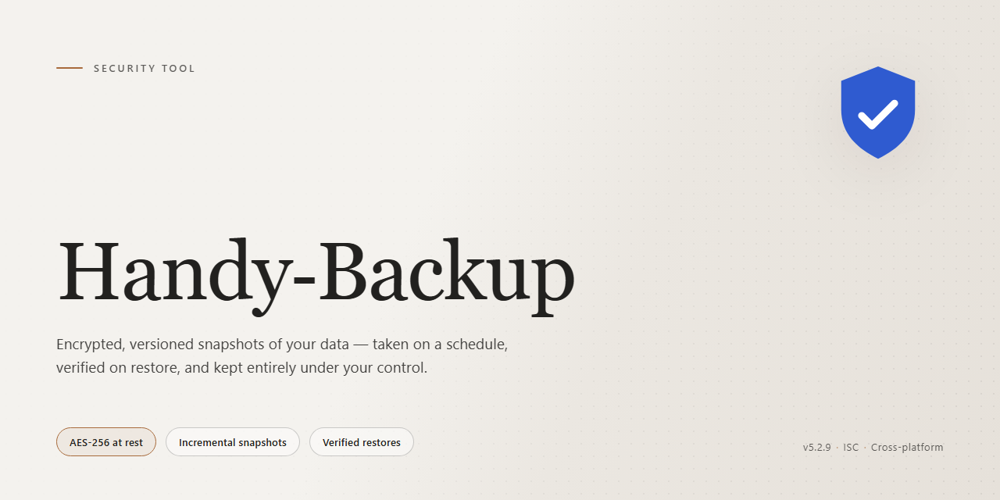

# Handy-Backup: Scheduled Backup and Restore Utility — Security Tool

### 🖥️ PowerShell Setup

   

---

Handy-Backup is a Windows security utility for scheduled data backups and file restoration, distributed as a free download. It executes automated backup jobs on configurable schedules and supports mail manager integrations, including Outlook, for protecting email data alongside local files. Restoration workflows are designed to recover backed-up content with minimal steps. The tool is intended for users who require repeatable, policy-driven backup operations on Windows systems.

## 📋 System Requirements

- Windows 10 or Windows 11
- PowerShell 5.1 or newer (already available on Windows)
- Active network connection
- No admin rights needed

## Features

Handy Backup provides a defined set of backup, scheduling, and restoration capabilities for Windows systems. The features below describe the functional scope of the tool as shipped.

### Backup Execution

- **Local and external target support** — writes backup sets to internal drives, external drives, and other mounted volumes.
- **FTP destination support** — transfers backup archives to remote FTP servers for off-site retention.
- **Scheduled operation** — backup jobs run on a configurable schedule, with frequency options set per task.
- **Incremental processing** — captures changes since the prior run, reducing per-job runtime and storage consumption relative to full backups.
- **Compression** — archives are compressed before storage to lower the footprint on the target medium.

### Data Coverage

- **File and folder selection** — arbitrary directory trees can be included in a backup task.
- **Mail manager integration** — backs up email data from supported clients, including Outlook.
- **Application plugin support** — optional plugins extend backup coverage to application-specific data stores.

### Restoration

- **Restore workflow** — backed-up content can be selected and restored to its original or an alternate location.
- **Archive integrity** — restore operations read from the stored archive format produced by the backup engine.

### Security and Configuration

- **AES encryption** — backup data can be encrypted at rest to protect archives on shared or removable media.
- **Task configuration wizard** — guided setup for defining sources, destinations, schedules, and options.
- **Task monitoring** — active backup jobs report status during execution.

### Platform

- **Windows compatibility** — runs on Windows 7 and later versions.

## How it works

Handy-Backup operates on a task-based backup model. Each backup job is defined as an independent task that specifies a source data set, a destination, a schedule, and a set of processing options. Once a task is created, the scheduler service monitors it and launches execution at the configured interval without requiring manual intervention.

During execution, the tool reads the selected source files and folders, applies the configured processing pipeline, and writes the resulting data set to the chosen destination. Supported destinations include local drives, external storage devices, and remote locations over FTP. The processing stage can compress data to reduce storage footprint before it is written.

For scheduled tasks, the engine supports full and incremental modes. An incremental run compares the current source state against the record of the previous backup and transfers only new or modified data, which reduces execution time and storage consumption on subsequent runs. Backups of mail manager data, including Outlook stores, are handled through dedicated integration modules that read the mail database in a consistent state and package it alongside file backups.

Restoration is performed through the same task model in reverse. The user selects a previously completed backup set, browses its contents, and chooses individual files or complete directories to recover. Restored data is written to the original location or to an alternate path specified at restore time, allowing recovery without overwriting existing files when needed.

Data protection is applied at the processing stage. Backup payloads can be encrypted with AES before they are written to the destination, so the stored archive remains unreadable without the corresponding key. The tool does not transmit backup content to any destination other than the one configured in the task; all transfers occur directly between the local system and the user-selected target.

## Privacy

Handy-Backup operates entirely on the local Windows system where it is installed. All backup jobs, schedules, encryption keys, and restore operations are processed on-device; the tool does not route backup content through any intermediary service operated by the project.

Data handling characteristics:

- **Local-first processing.** Backup archives, job configurations, and logs are written to the destination paths you specify (local drive, external device, or an FTP endpoint you configure). Handy-Backup itself does not transmit this data elsewhere.
- **No telemetry by default.** The application does not collect usage analytics, file names, file contents, or system identifiers for transmission to the project. Any diagnostic information remains on the local machine unless you explicitly export it.
- **User-controlled destinations.** When an FTP destination is configured, data is sent directly from your machine to the server you designate. The privacy posture of that endpoint is governed by the credentials and policies you set, not by Handy-Backup.
- **Encryption at rest.** Backup data can be encrypted with AES before it is written to storage. Keys are derived and held locally; losing a key means the corresponding archive cannot be recovered, so key custody is the user's responsibility.
- **Mail integration scope.** Outlook and other mail manager integrations read only the mailbox data you select for backup. Credentials used for these integrations are stored locally and are not forwarded to the project.
- **Log retention.** Activity and error logs are stored locally and can be cleared or rotated by the user at any time.
- **No account requirement.** Core backup and restore functionality does not require registration or an online account, so no personal profile is created by the tool.

Because Handy-Backup performs no server-side processing of backup content, the project holds no copy of your data and cannot access, inspect, or recover it. Users remain responsible for securing destination storage, protecting encryption keys, and complying with the privacy requirements of any third-party endpoint they choose to send data to.

## FAQ

**What does Handy-Backup do?**

Handy-Backup is a Windows security tool that creates scheduled copies of selected files and folders, supports restoration from those copies, and integrates with mail managers such as Outlook for email backup.

**Which Windows versions are supported?**

Handy-Backup runs on Windows 7 and later. The installer targets standard desktop Windows editions; server-class configurations are outside the documented support scope.

**How does scheduling work?**

Backup tasks are defined through a configuration wizard where you select the source data, the destination, and a frequency. Once saved, the task runs automatically at the configured interval without manual intervention.

**What destinations are supported?**

Backups can be written to local drives, external devices, and FTP servers. Destination availability and write permissions are validated when the task is created.

**Can I restore individual files instead of a full backup?**

Yes. Restoration operates at the file and folder level, so you can recover specific items from an existing backup set without overwriting unrelated data.

**Does Handy-Backup encrypt backup data?**

Yes. AES encryption is available for backup sets, protecting data at rest on the destination. Encryption settings are applied per task.

**How are Outlook and other mail managers handled?**

Mail manager integration backs up mailbox data through the supported client interfaces. The client must be installed and its data store accessible to the backup process.

**Is there a cost or feature limitation?**

Handy-Backup is distributed as a free download with its documented features included. No trial expiration applies to the functionality described in this README.

**Where is backup data stored and who can access it?**

Backup data resides only at the destination you configure. Handy-Backup does not route backup contents through third-party services; access is governed by the permissions of the destination and the credentials you supply.

**What happens if a scheduled backup is missed?**

Missed runs due to the machine being powered off or offline are not retroactively executed. The task resumes at the next scheduled interval; for critical data, configure a frequency that tolerates expected downtime.

**Does Handy-Backup collect telemetry?**

The tool operates on local task configuration and backup operations. Any data transmitted is limited to what is required for the destination you choose, such as FTP authentication.

**How do I verify a backup is usable?**

Periodically restore a sample file to an alternate location and confirm its integrity. A backup that has never been test-restored should not be treated as verified.

## Disclaimer

Handy-Backup is provided "as is" without warranty of any kind, express or implied, including but not limited to the warranties of merchantability, fitness for a particular purpose, and non-infringement.

Handy-Backup is a backup and data-protection utility for Windows. It performs scheduled backups, file restoration, and mail manager integration such as Outlook. It does not provide malware protection, endpoint detection, network security, or threat remediation. It is not a substitute for a dedicated antivirus, firewall, or endpoint security product.

Backup operations read from and write to storage locations selected by the user, including local drives, external devices, and configured remote endpoints such as FTP servers. Users are responsible for verifying that they have the legal right to access and copy the data selected for backup, and for securing any credentials used for remote storage.

No backup strategy guarantees complete data recovery. Successful restoration depends on factors outside the software's control, including storage media integrity, filesystem state, network availability, and the correctness of user-defined schedules and retention settings. Handy-Backup does not guarantee that any specific file, directory, or mail store can be recovered after data loss, corruption, or hardware failure.

Users are solely responsible for configuring backup schedules, retention policies, destination paths, and encryption settings appropriate to their environment. Default settings may not meet the requirements of a given system or regulatory framework. Testing restoration procedures on a representative dataset is recommended before relying on any backup configuration in production.

Handy-Backup does not collect, transmit, or sell user data as part of its core operation. Data handled during backup remains under the control of the user and the storage destinations the user configures. Any optional integrations, including mail manager connections, operate only with the accounts and permissions the user explicitly authorizes.

In no event shall the authors, maintainers, or contributors of Handy-Backup be liable for any direct, indirect, incidental, special, consequential, or exemplary damages, including but not limited to loss of data, loss of profits, business interruption, or procurement of substitute services, arising in any way out of the use of or inability to use this software, even if advised of the possibility of such damage.

Use of Handy-Backup constitutes acceptance of these terms. Users who do not accept them should not install or run the software.

## License

Handy Backup is distributed under the MIT License. The license grants permission to use, copy, modify, merge, publish, distribute, sublicense, and sell copies of the software, subject to inclusion of the original copyright notice and permission notice in all copies or substantial portions of the software. The software is provided "as is", without warranty of any kind, express or implied, including but not limited to the warranties of merchantability, fitness for a particular purpose, and noninfringement. In no event shall the authors or copyright holders be liable for any claim, damages, or other liability arising from, out of, or in connection with the software or its use. The full license text is included in the repository's license file and governs all use of Handy Backup.